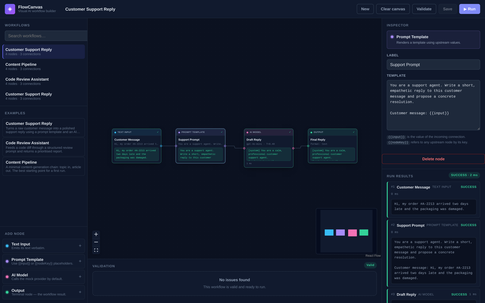
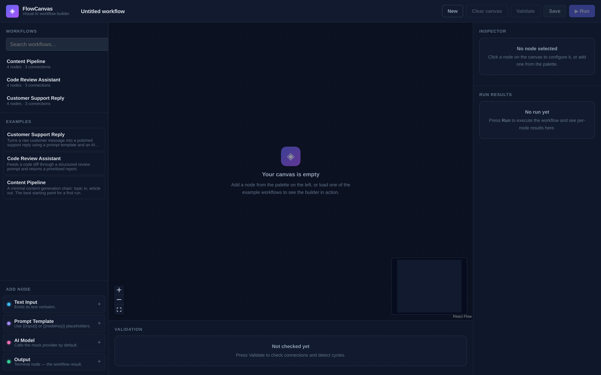
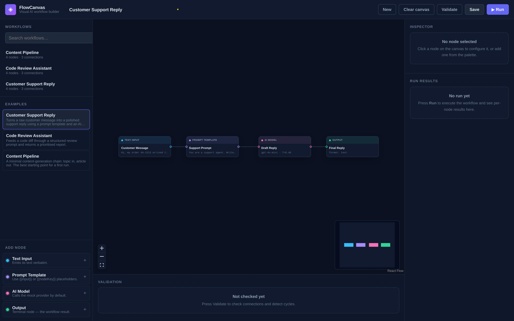
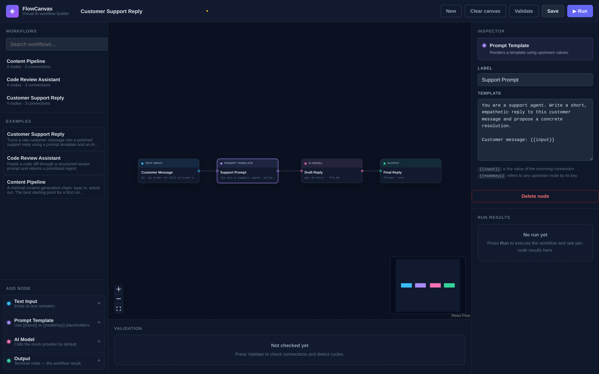
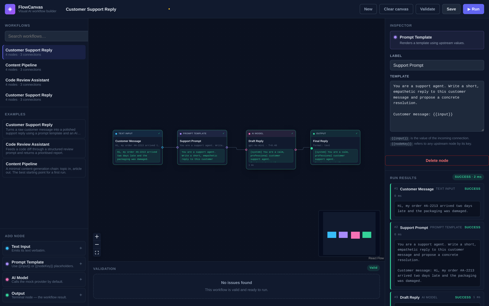
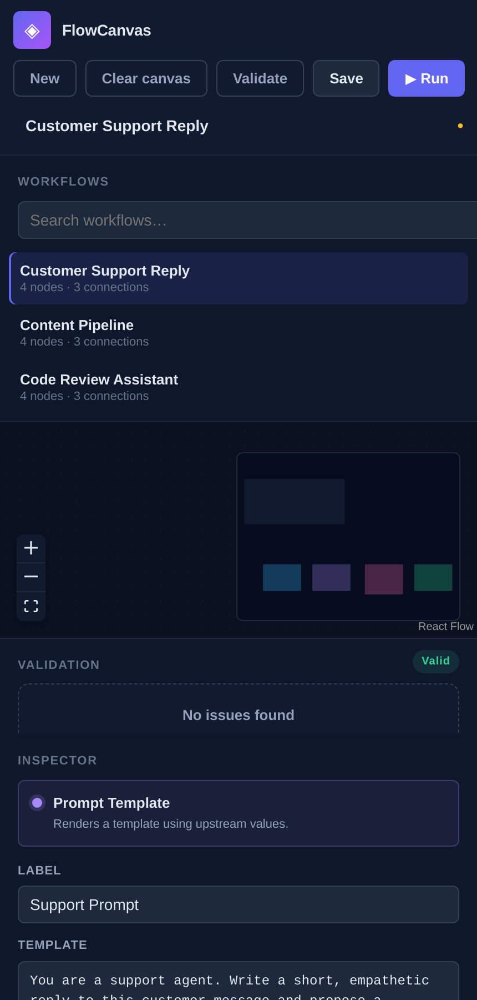
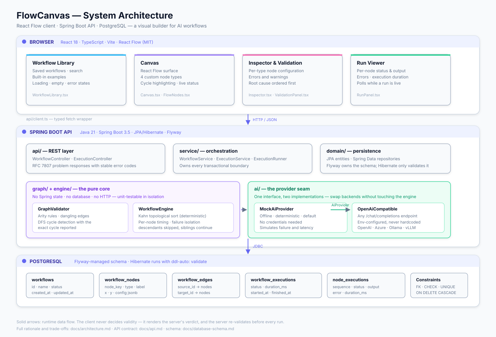
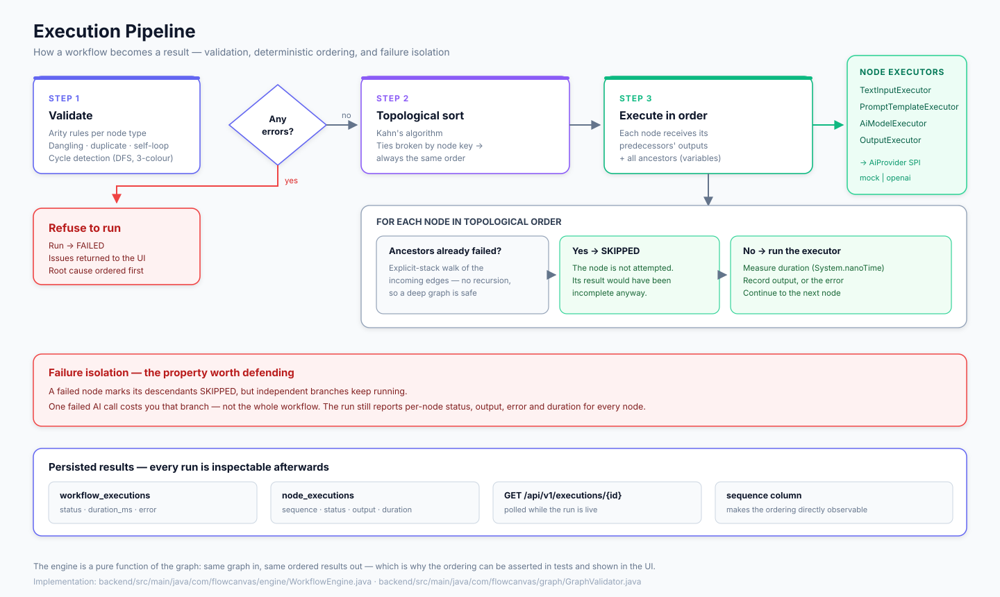

<div align="center">

# ◈ FlowCanvas

### A visual builder for AI workflows — design it, validate it, run it.

**React Flow** · **Spring Boot** · **PostgreSQL** · **Docker**

[](backend/src/test)
[](frontend/src/test)
[](backend/pom.xml)
[](LICENSE)

</div>

---

FlowCanvas lets you draw a pipeline of AI nodes on a canvas, connect them, and press
**Run**. The backend validates the graph, refuses cycles and illegal connections, executes
the nodes in dependency order, and streams each node's status to the canvas as it runs —
what it produced, how long it took and what went wrong.

It runs **completely offline** with a deterministic mock AI provider, so the whole product
is demonstrable with zero API budget — and a real provider (any OpenAI-compatible endpoint)
is one environment variable away.



---

## Table of contents

- [Highlights](#highlights)
- [Screenshots](#screenshots)
- [Architecture](#architecture)
- [Quick start](#quick-start)
- [Running without Docker](#running-without-docker)
- [Configuration](#configuration)
- [Using a real AI provider](#using-a-real-ai-provider)
- [Project layout](#project-layout)
- [How it works](#how-it-works)
- [API](#api)
- [Database](#database)
- [Testing](#testing)
- [Design decisions](#design-decisions)
- [Design Q&A](#design-qa)
- [Limitations and next steps](#limitations-and-next-steps)
- [License](#license)

---

## Highlights

| | |
|---|---|
| **Interactive canvas** | Create, move, connect, configure and delete nodes on a [React Flow](https://github.com/xyflow/xyflow) canvas (MIT). Four typed nodes: Text Input, Prompt Template, AI Model and Output. |
| **Real validation** | Cycle detection with the exact cycle named in edge order, per-node connection rules, dangling and duplicate edges, unique node keys, and **static checking of template variables** — a `{{typo}}` is caught while editing, before any model is called. Validated client-side for instant feedback and again on the server, which is the authority. |
| **Fan-out / fan-in** | Branches run independently and a Prompt Template can join them by key: `Arguments for: {{advocate}} / against: {{critic}}`. Variables are lexically scoped to a node's ancestors, so a template never depends on tie-breaking. |
| **Dependency-ordered execution** | Kahn's topological sort with deterministic tie-breaking. A node only runs once every predecessor has produced a value. |
| **Failure isolation** | A failed node marks its descendants *skipped* while independent branches keep running. One bad AI call costs you that branch, not the workflow. |
| **Live run progress** | The full plan is persisted up front; each node flips `PENDING → RUNNING → SUCCESS/FAILED/SKIPPED` as it happens, so the canvas animates the real run. Every event commits in its own short transaction — no DB connection is held across a model call. |
| **Per-node observability** | Status, output, error, start/finish time and duration for every node, persisted with a browsable run history per workflow. |
| **Atomic saves** | Workflow metadata and graph are written in one transaction; a graph the schema cannot store is rejected with `422` and per-node issues, never a half-saved workflow or a raw constraint `500`. |
| **Pluggable, resilient AI** | An `AiProvider` interface with a deterministic offline mock (default) and an OpenAI-compatible provider with request timeouts and retries with exponential backoff on `429`/`5xx`/network errors (honouring `Retry-After`), but none on `4xx`. |
| **Crash-safe runs** | A run always terminates: unexpected failures mark it `FAILED`, and runs orphaned by a restart are closed at startup instead of spinning forever. |
| **No secrets in the repo** | Credentials come from the environment. `.env` is git-ignored; `.env.example` documents every variable. |
| **Real tests** | 77 backend tests (integration tests against a real embedded PostgreSQL, and the AI client against a real local HTTP server) and 51 frontend tests. |
| **One-command setup** | `docker compose up --build` starts the database, the API and the frontend. CI runs the whole suite on every push. |

---

## Screenshots

| | |
|---|---|
| **Empty state**<br>Clear guidance instead of a blank canvas.<br><br> | **A loaded workflow**<br>Four typed nodes with live previews.<br><br> |
| **Node inspector**<br>Type-specific configuration for the selected node.<br><br> | **Execution results**<br>Per-node status, output and duration.<br><br> |
| **Canvas editing**<br>Delete an edge, drag a new connection.<br><br> | **Responsive layout**<br>Works down to a phone width.<br><br> |

---

## Architecture



<details>
<summary>Execution pipeline</summary>



</details>

**The layers, and what each one is allowed to know:**

```
frontend/   React 18 · TypeScript · Vite · React Flow
            └── talks to the API over a documented JSON contract

backend/    Java 21 · Spring Boot 3.5
            ├── api/      controllers, DTOs, RFC 7807 error handling
            ├── service/  orchestration and transaction boundaries
            ├── graph/    graph model + validation  (no Spring, no DB)
            ├── engine/   execution                  (no HTTP, no DB)
            ├── ai/       AiProvider SPI
            └── domain/   JPA entities

database/   PostgreSQL 16 · Flyway migrations · 5 tables
```

The rule that keeps the codebase honest: **`graph/`, `engine/` and `ai/` never import
from `api/` or `domain/`**. They work on plain immutable values, which is why the
interesting logic is testable without Spring, without a database and without an HTTP server.

Full rationale, including the trade-offs: **[docs/architecture.md](docs/architecture.md)**

---

## Quick start

### With Docker (recommended)

```bash
git clone https://github.com/<your-username>/flowcanvas.git
cd flowcanvas

cp .env.example .env          # every value has a safe default — no edits needed
docker compose up --build
```

Open **http://localhost:5173**.

| Service | URL | Notes |
|---|---|---|
| Web client | http://localhost:5173 | nginx serves the built app and proxies `/api` |
| REST API | http://localhost:8080 | REST API root |
| Swagger UI | http://localhost:8080/swagger-ui.html | Interactive API documentation |
| Health | http://localhost:8080/actuator/health | Liveness and readiness |
| PostgreSQL | localhost:5432 | `flowcanvas` / `postgres` / `postgres` |

The database is migrated by **Flyway** on startup and four example workflows are seeded
automatically, so the app opens with something real to look at.

To stop and wipe the data:

```bash
docker compose down -v
```

---

## Running without Docker

Requires **JDK 21**, **Maven 3.9+**, **Node 20+** and a **PostgreSQL 15+** instance.

### 1. Database

```bash
createdb flowcanvas
```

### 2. Backend

```bash
cd backend
export DB_URL=jdbc:postgresql://localhost:5432/flowcanvas
export DB_USERNAME=postgres
export DB_PASSWORD=postgres

mvn spring-boot:run          # http://localhost:8080
```

### 3. Frontend

```bash
cd frontend
npm install
npm run dev                  # http://localhost:5173
```

The Vite dev server proxies `/api` to `http://localhost:8080`, so the browser only ever
sees one origin and CORS never enters the picture.

### Useful scripts

| Script | What it does |
|---|---|
| `./scripts/dev-backend.sh start\|stop\|restart\|status` | Manages a local backend process. |
| `./scripts/reset-db.sh` | Drops and recreates the database (then restart the backend to re-migrate). |
| `node scripts/capture-screenshots.mjs` | Drives the real UI in a real browser and captures the README screenshots. |

---

## Configuration

Every setting is an environment variable. Copy `.env.example` to `.env`; nothing has to be
changed to get a working system.

| Variable | Default | Purpose |
|---|---|---|
| `DB_URL` | `jdbc:postgresql://localhost:5432/flowcanvas` | JDBC connection string. |
| `DB_USERNAME` / `DB_PASSWORD` | `postgres` / `postgres` | Database credentials. |
| `SERVER_PORT` | `8080` | API port. |
| `AI_PROVIDER` | `mock` | `mock` (offline) or `openai`. |
| `AI_API_KEY` | *(empty)* | Bearer token. **Only read from the environment — never committed.** |
| `AI_BASE_URL` | `https://api.openai.com/v1` | Any OpenAI-compatible base URL. |
| `AI_MODEL` | `gpt-4o-mini` | Default model identifier. |
| `AI_TIMEOUT_SECONDS` | `60` | Per-request connect and read timeout. |
| `AI_MAX_RETRIES` | `2` | Retries for `429`, `5xx` and network errors, with exponential backoff. |
| `AI_MOCK_LATENCY_MS` | `600` | Simulated latency per mock call, so live progress is visible in the demo. |
| `EXECUTION_MAX_CONCURRENT` | `4` | Size of the workflow execution pool. |
| `EXECUTION_QUEUE_CAPACITY` | `64` | Bounded queue for queued runs. |
| `SEED_EXAMPLES` | `true` | Seed the example workflows on first start. |
| `VITE_PROXY_TARGET` | `http://localhost:8080` | Dev-server proxy target. |
| `VITE_API_BASE_URL` | *(empty)* | Absolute API URL; blank means same-origin. |

> **Secrets.** There is no credential anywhere in this repository. `AI_API_KEY` is resolved
> through Spring's `${...}` placeholder syntax, defaults to blank, and is never logged —
> the provider reports only whether a key is *present*. `.env` is git-ignored.

---

## Using a real AI provider

The `AiProvider` interface is the only seam the engine knows about:

```java
public interface AiProvider {
    String name();
    default boolean isRemote() { return false; }
    AiResponse complete(AiRequest request);
}
```

Switching implementations is configuration, not code:

```bash
AI_PROVIDER=openai
AI_API_KEY=sk-...
AI_BASE_URL=https://api.openai.com/v1
AI_MODEL=gpt-4o-mini
```

Every request is bounded by `AI_TIMEOUT_SECONDS`. Rate limits (`429`), server errors (`5xx`)
and network failures are retried up to `AI_MAX_RETRIES` times with exponential backoff,
honouring a `Retry-After` header; a `401` or `404` fails immediately, because retrying it only
burns time and quota. The tests drive the real HTTP client against a local server to prove it.

Because the provider speaks the OpenAI `chat/completions` shape, the same variables point
it at **Azure OpenAI, Together, Groq, Ollama or vLLM** — change `AI_BASE_URL` and nothing
else.

Adding a genuinely different vendor means writing one class:

```java
@Component
@ConditionalOnProperty(name = "flowcanvas.ai.provider", havingValue = "anthropic")
public class AnthropicProvider implements AiProvider {
    @Override public String name() { return "anthropic"; }

    @Override
    public AiResponse complete(AiRequest request) {
        // … call the Anthropic Messages API …
    }
}
```

The **mock provider is not a stub**: it hashes the prompt to produce a stable fingerprint,
so the same input always yields the same output (reproducible golden tests, no UI flicker),
and it simulates failure (`[[fail]]`) and latency (`[[slow]]`) so the error and loading
paths are real code paths rather than hard-coded UI states.

---

## Project layout

```
flowcanvas/
├── backend/
│   ├── src/main/java/com/flowcanvas/
│   │   ├── api/          controllers · DTOs · GraphMapper · error handling
│   │   ├── ai/           AiProvider · MockAiProvider · OpenAiCompatibleProvider
│   │   ├── config/       AppConfig · AiProperties · ExampleSeeder
│   │   ├── domain/       JPA entities · enums
│   │   ├── engine/       WorkflowEngine · NodeExecutors · ExecutionListener
│   │   ├── graph/        WorkflowGraph · GraphValidator · TemplateVariables
│   │   ├── repository/   Spring Data repositories
│   │   └── service/      WorkflowService · ExecutionService · ExecutionRunner · examples
│   ├── src/main/resources/db/migration/V1__init_schema.sql
│   └── src/test/java/…   77 tests
│
├── frontend/
│   ├── src/
│   │   ├── api/          typed fetch client
│   │   ├── components/   Canvas · Toolbar · Inspector · RunPanel · ValidationPanel · …
│   │   ├── nodes/        FlowNodes · definitions · graph rules · node keys
│   │   ├── test/         51 tests
│   │   ├── App.tsx       application root and state
│   │   └── styles.css    the design system
│   └── vite.config.ts
│
├── docs/
│   ├── architecture.md        design, rationale and trade-offs
│   ├── api.md                 the full REST contract
│   ├── database-schema.md     tables, constraints and indexes
│   ├── architecture-diagram.svg
│   ├── execution-pipeline.svg
│   └── screenshots/
│
├── scripts/            dev-backend.sh · reset-db.sh · capture-screenshots.mjs
├── docker-compose.yml
└── .github/workflows/ci.yml
```

---

## How it works

### The node contract

Every node emits exactly one text value, which becomes the input of its successors.

| Type | Incoming | Outgoing | Configuration | Output |
|---|---|---|---|---|
| **Text Input** | 0 | 0..n | `{ text }` | The literal text. |
| **Prompt Template** | 1..n | 0..n | `{ template }` | The rendered template. |
| **AI Model** | exactly 1 | 0..n | `{ model, systemPrompt, temperature }` | The provider's completion. |
| **Output** | 1..n | 0 | `{ format: text \| json }` | The collected input(s). |

Every node has a short, readable **key** (`topic`, `advocate`, `prompt2`), generated when it
is added, shown on the node and editable in the inspector. Template placeholders:
`{{input}}` is the direct input (several inputs are joined in key order); `{{nodeKey}}`
addresses an **ancestor** by its key. The inspector lists exactly the variables in scope, and
an unknown placeholder is a validation error rather than an empty string — a template that
silently renders to nothing is the classic way a workflow "succeeds" while producing
nonsense.

### A run, step by step

1. **Validate** — arity rules, dangling and duplicate edges, self-loops, unique node keys,
   template references, and cycle detection by depth-first search with a three-colour
   marking scheme. The *exact* cycle is reported in edge order (`A → B → C → A`), not merely
   "a cycle exists".
2. **Order** — Kahn's topological sort over a priority queue, with ties broken by node key
   so the order is **deterministic**: the same graph always executes in the same sequence.
3. **Execute** — each node receives its predecessors' outputs plus the outputs of its
   ancestors, and its duration is measured with `System.nanoTime()`.
4. **Isolate failures** — a failed node marks its descendants *skipped* while independent
   branches continue.
5. **Persist, live** — an `ExecutionListener` writes the plan as `PENDING` rows, then every
   status change as it happens, including the `sequence`, so the dependency ordering is
   directly observable in the database — and in the UI while the run is still going.

### The asynchronous run and its transaction boundary

`POST /workflows/{id}/execute` returns `202 Accepted`; the client polls
`GET /executions/{id}`. A slow model call therefore never holds an HTTP thread open, and
the UI gets a run to animate.

The transaction structure is the subtle part, and it was the source of a genuine race
during development:

```
ExecutionService.startAsync(workflowId)          ← deliberately NOT @Transactional
  ├─ workflowService.saveExecution(execution)    ← own transaction — COMMITS here
  └─ executor.execute(() -> ExecutionRunner.run(...))
                                                  ↑ dispatched only AFTER the commit
ExecutionRunner.run(...)                          ← also NOT @Transactional
  └─ engine.execute(graph, listener)
       ├─ onPlanned       → insert PENDING rows   ← short transaction
       ├─ onNodeStarted   → RUNNING               ← short transaction
       │    … model call: no connection held …
       └─ onNodeFinished  → SUCCESS/FAILED/…      ← short transaction
```

Three rules follow, and all are worth being able to explain:

1. **The execution row must be committed before the worker starts.** The worker inserts
   `node_executions` rows that reference it; if it ran first the foreign key would fail.
   This was a real race — the unit test passed by luck, and the browser caught it. There is
   now a regression test that starts five concurrent runs.
2. **The worker lives in a separate bean.** Spring applies `@Transactional` through a
   proxy, so a method calling another `@Transactional` method *on itself* bypasses the
   proxy and runs with **no transaction at all**. A separate bean makes the boundary real.
3. **No transaction spans a model call.** An earlier version wrapped the whole run in one
   transaction, which pinned a pooled connection for the full duration of every model call
   — a handful of slow runs would have starved the entire API. Each event now commits on
   its own, which is also what makes live progress possible.

---

## API

Base URL `/api/v1`. Full documentation: **[docs/api.md](docs/api.md)**.

| Method | Path | Purpose |
|---|---|---|
| `GET` | `/workflows` | List (paged, searchable). |
| `POST` | `/workflows` | Create with its graph. |
| `GET` | `/workflows/{id}` | Read with the full graph. |
| `PUT` | `/workflows/{id}` | Update and replace the graph. |
| `DELETE` | `/workflows/{id}` | Delete (cascades to nodes, edges and runs). |
| `POST` | `/workflows/validate` | Validate a graph without saving it. |
| `GET` | `/workflows/examples` | The built-in example graphs. |
| `POST` | `/workflows/{id}/execute` | Start a run → `202` + execution id. |
| `GET` | `/workflows/{id}/executions` | Run history. |
| `GET` | `/executions/{id}` | A run and its per-node results. |

Errors are **RFC 7807** problem responses with a stable `code`, so a client reacts to
*problems* rather than to message text:

```json
{
  "type": "about:blank",
  "title": "Invalid request",
  "status": 400,
  "detail": "The request body failed validation.",
  "code": "VALIDATION_FAILED",
  "errors": [{ "field": "name", "message": "must not be blank" }]
}
```

---

## Database

PostgreSQL, managed by Flyway. Hibernate runs with `ddl-auto: validate`, so the
application never alters the schema — it only checks that the code and the schema agree,
turning drift into a startup failure instead of a runtime surprise.

```
workflows ─┬─< workflow_nodes ──< workflow_edges >── workflow_nodes ─┘
           │        (source_id, target_id)
           │
           └─< workflow_executions ──< node_executions
```

| Table | Purpose |
|---|---|
| `workflows` | The aggregate root: name, description, status, timestamps. |
| `workflow_nodes` | One row per node. `config` is `jsonb`, because its shape belongs to the node type and must evolve without a migration. |
| `workflow_edges` | Connections, with a `CHECK` against self-loops and a `UNIQUE` constraint on the node pair. |
| `workflow_executions` | One row per run, with status and total duration. |
| `node_executions` | One row per node per run: status, output, error, duration and the resolved `sequence`. |

Deleting a workflow cascades to its nodes, edges and entire run history.

Full schema, constraints and indexes: **[docs/database-schema.md](docs/database-schema.md)**

---

## Testing

```bash
cd backend  && mvn test        # 77 tests
cd frontend && npm run test     # 51 tests
```

| Layer | Tool | What it proves |
|---|---|---|
| Backend unit | JUnit 5 | Cycle detection and cycle naming, arity and key rules, template scoping, topological order and tie-breaking, failure isolation, listener events, every shipped example. |
| AI client | JUnit 5 + JDK `HttpServer` | Timeouts, retries on `503`/`429`, no retry on `401`, headers and payload — against a real local HTTP server. |
| Backend integration | JUnit 5 + **embedded PostgreSQL** | Flyway migrations, `jsonb` round-trip, cascade deletes, the REST surface, atomic saves, literal search, live run progress, recovery of interrupted runs. |
| Frontend unit | Vitest | Graph rules mirrored from the server, node keys and variable scoping, API error mapping, payload conversion. |
| Frontend component | Vitest + Testing Library | Rendering, inspector editing, key generation and clash warnings, save and run flows, run history, empty/loading/error states. |
| End-to-end *(optional)* | Playwright | The real UI in a real browser against the real backend. |

**Why embedded PostgreSQL instead of Testcontainers?** Testcontainers needs a Docker
daemon, which makes the suite unrunnable on a plain laptop or in a CI job without
Docker-in-Docker. The embedded server is a *real* PostgreSQL — real `jsonb`, real
constraints, real transactional semantics — with no external dependency, and it starts in
about a second. The CI workflow therefore needs no database service container, and
`mvn test` means exactly the same thing on every machine.

The end-to-end script drives the actual application and captures the screenshots in this
README:

```bash
node scripts/capture-screenshots.mjs
```

---

## Design decisions

The choices worth defending, and why.

**1. Replace the graph on save, instead of diffing it.**
The browser always holds the complete graph, so a full rewrite is the honest model. For
graphs of tens of nodes the write cost is irrelevant, and the correctness win is total:
no stale rows, no orphaned edges, no half-saved state.

**2. Client-generated node and edge ids.**
The browser mints the UUIDs, so a graph round-trips without server-side remapping and
React Flow keeps using its own handles as stable keys. Workflow ids stay server-generated,
because they are the resource identity.

**3. `jsonb` for node configuration.**
Adding a `systemPrompt` field to the AI Model node must not require a database migration.
The configuration shape belongs to the node type, not to the relational schema.

**4. The server is the authority on validity.**
The frontend duplicates the rules for *instant* feedback; the server re-validates before
every run. The duplication is deliberate and bounded — both implementations are short and
both are tested.

**5. A pure core.**
`graph/`, `engine/` and `ai/` have no Spring, database or HTTP dependencies. That is what
makes the execution-order and cycle tests fast, precise and free of setup.

**6. Errors as codes, not strings.**
Every failure carries a stable `code`. The UI reacts to `CYCLE_DETECTED`, not to a
substring of an English sentence.

**7. Keys are names; ids are identity.**
A node has a UUID (stable identity for the canvas and the database) and a short key (what a
human types in a template). Conflating the two — as an earlier version did — makes
`{{nodeKey}}` technically supported and practically unusable.

**8. Check templates statically.**
An unknown variable is a validation error, not a runtime failure: a broken template should
not cost three paid model calls before it fails at the fourth node.

**9. Execution history is a first-class table.**
A run is worth keeping: `node_executions` keeps the node's key, type and label as a
snapshot, so history stays readable after the graph has changed.

---

## Design Q&A

The questions a reviewer is most likely to ask:

**"How do you know the workflow runs in the right order?"**
The engine produces a topological order with Kahn's algorithm over a priority queue,
breaking ties by node key so the order is deterministic. The `sequence` column in `node_executions` records that
order, the API returns it, and the tests assert it — including for a diamond graph where
a node must come after *both* of its producers.

**"What happens when a node fails?"**
The failure is caught and recorded against that node; its descendants are marked
`SKIPPED` rather than being run with missing inputs, and independent branches continue.
The run ends as `FAILED`, but everything that could succeed still did, and every node has
a status, an output or an error, and a duration.

**"How do you detect a cycle?"**
A depth-first search with a three-colour marking scheme: `WHITE` (unvisited), `GREY` (on
the current path) and `BLACK` (fully explored). An edge to a `GREY` node is a back edge,
and the current path is reconstructed to name the exact cycle. Kahn's algorithm then
doubles as a second, independent check: if it cannot consume every node, the graph has a
cycle.

**"Why not store the configuration in columns?"**
Because the shape is owned by the node type and changes independently of the schema. A
column per field means a migration every time the node taxonomy grows.

**"Why is the API asynchronous?"**
A model call can take seconds. Holding an HTTP thread open for that is wasteful, and
`202 Accepted` plus polling lets the UI show real progress instead of a spinner over a
frozen request. Every node's status is committed as it changes, so a partially completed
run is fully inspectable — and a run interrupted by a restart is closed as `FAILED` at
startup rather than reported as running forever.

**"Can a template read any node?"**
No — only its ancestors. An earlier version exposed every node that had *already run*,
which meant a template could read a sibling branch or not depending on how ties in the
topological order happened to break. Scoping variables to ancestors made templates
deterministic, and made it possible to check every reference statically.

**"What was the hardest bug?"**
A race between the execution row and the node results: the async worker could insert
`node_executions` rows before the `workflow_executions` row was committed, and the
foreign key would fail. The unit test passed by luck; driving the real application in a
browser exposed it. The fix was structural — commit the execution row before dispatching
the worker, and move the worker into its own bean so Spring's transaction proxy actually
applies (a self-invoked `@Transactional` method silently runs with no transaction). There
is now a regression test that starts five concurrent runs.

**"What would you change with more time?"**
Parallel execution of independent branches (the listener and per-event persistence are
already thread-agnostic), server-sent events instead of polling, cancellation of a running
workflow, workflow versioning with diffs, and authentication with per-workflow ownership.

---

## Limitations and next steps

Deliberately out of scope for the MVP:

- **No authentication.** The project is a portfolio demo; adding auth means a user table,
  a token flow and per-workflow ownership.
- **Sequential execution.** Independent branches could run concurrently.
- **Polling, not push.** Progress is persisted live, but the UI polls for it every 400 ms; SSE
  would cut the request count and the perceived latency.
- **No cancellation.** A started run always runs to completion (the schema already has a
  `CANCELLED` status).
- **No workflow versioning.** Saving replaces the graph; there is no history of edits.
- **One provider shape.** The OpenAI-compatible protocol covers most vendors, but a
  vendor with a genuinely different API needs its own `AiProvider` implementation.

---

## License

MIT. The canvas is built on [React Flow](https://github.com/xyflow/xyflow), which is
also MIT licensed — this is an independent application built *on* the library, not a
rebranded copy of it.

```
MIT License

Copyright (c) 2026 FlowCanvas contributors

Permission is hereby granted, free of charge, to any person obtaining a copy
of this software and associated documentation files (the "Software"), to deal
in the Software without restriction, including without limitation the rights
to use, copy, modify, merge, publish, distribute, sublicense, and/or sell
copies of the Software, and to permit persons to whom the Software is
furnished to do so, subject to the following conditions:

The above copyright notice and this permission notice shall be included in all
copies or substantial portions of the Software.

THE SOFTWARE IS PROVIDED "AS IS", WITHOUT WARRANTY OF ANY KIND, EXPRESS OR
IMPLIED, INCLUDING BUT NOT LIMITED TO THE WARRANTIES OF MERCHANTABILITY,
FITNESS FOR A PARTICULAR PURPOSE AND NONINFRINGEMENT. IN NO EVENT SHALL THE
AUTHORS OR COPYRIGHT HOLDERS BE LIABLE FOR ANY CLAIM, DAMAGES OR OTHER
LIABILITY, WHETHER IN AN ACTION OF CONTRACT, TORT OR OTHERWISE, ARISING FROM,
OUT OF OR IN CONNECTION WITH THE SOFTWARE OR THE USE OR OTHER DEALINGS IN THE
SOFTWARE.
```
